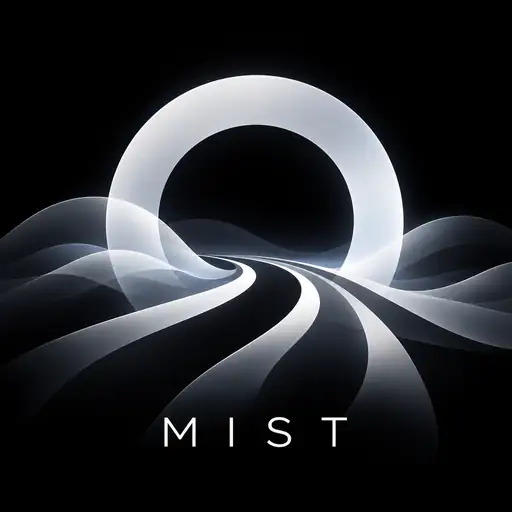

<p align="center"></p>
<h1 align="center">MIST UI</h1>

Минималистичная серверная панель для **MIST — Multiprotocol Internet Secure Transport**, адаптированная из [Sudoku UI](https://github.com/sanderstripa/sudoku-ui).

## Быстрая установка

На **Ubuntu или Debian**, от `root`:

```bash
bash <(curl -fsSL https://raw.githubusercontent.com/sanderstripa/mist-ui/main/install.sh)
```

Установщик скачивает стабильный выпуск, проверяет SHA-256, устанавливает панель и совместимое ядро, выпускает доверенный TLS-сертификат на IPv4 без покупки домена и включает автоматическое продление. Поддерживаются amd64 и arm64. Во время установки выбираются адрес VPS, порт панели, логин и пароль.

По умолчанию: **MIST TCP/UDP 443**, **панель HTTPS 2097**. TCP 80 должен быть доступен для выдачи и продления сертификата. Откройте эти порты также в firewall провайдера. Занятые порты не освобождаются остановкой чужих служб: установщик завершится с понятной ошибкой. Xray, 3xUI и Sudoku он не изменяет.

Если на VPS уже есть IPv4 MIST в `/etc/mist/server.json` с `authority`, равным IP VPS, и подсетью `/24`, установщик сохраняет токен и адрес существующего устройства, делает резервную копию и подключает панель. Старую рабочую ссылку менять не нужно. Ядро будет кратко перезапущено. Конфигурации с HMAC `token_secret` или внутренним IPv6-туннелем требуют явной миграции; установщик не делает скрытую ротацию ключей и не выключает старый IPv6-туннель.

## Использование

1. Откройте HTTPS-адрес панели, который напечатал установщик.
2. Войдите, нажмите **«Новый ключ»**, задайте название устройства и срок.
3. Скопируйте ссылку или скачайте JSON. В [Connect](https://github.com/sanderstripa/connect): **Добавить → вставить ссылку → Подключить**.
4. Для другого устройства создайте отдельный ключ. Разные ключи могут подключаться одновременно на одном порту.
5. **Отключить** временно блокирует ключ. **Отозвать** блокирует его навсегда. Активный поток закрывается при ближайшей проверке политики, обычно в течение секунды.

Доступны запуск, остановка и перезапуск MIST, журнал, смена пароля, настройки порта и DNS, светлая и тёмная темы. Смена порта проверяет доступность TCP и UDP, кратко перезапускает ядро и требует обновления импортированных ссылок. TCP 80 зарезервирован для сертификата. Панель не показывает выдуманный трафик: счётчики приходят из ядра и относятся к текущему запуску. QR-код содержит ту же личную ссылку `mist://`, а не общий ключ сервера.

## Что изменено в MIST

Исходное ядро `mist-hardening-32` поддерживало один клиент. Включённая версия распределяет ответы TUN по индивидуальному IPv4 устройства, выделяет отдельные HTTP/3 lane-сессии, проверяет источник IP-пакета и закрывает отозванные/истёкшие ключи без перезапуска остальных клиентов. Поддержаны HTTP/3 lanes, CONNECT-IP/HTTP/3 и HTTP/2/TLS. Формат клиента совместим с Connect: индивидуальный адрес передаётся в `fallback_client_cidr`.

Панель обслуживает один MIST Edge и IPv4 `/24` (до 253 адресов устройств). Один ключ — одна одновременная сессия; адреса отозванных устройств не переиспользуются, чтобы старые потоки не попали к новому устройству. IPv6 в выдаваемых профилях заблокирован. Xray и системный прокси не являются транспортами MIST.

Административная часть работает только по HTTPS, с bcrypt-паролем, ограничением попыток входа, HttpOnly/Secure/SameSite cookie и CSRF-защитой. Ключи и состояние хранятся в root-only файлах. Случайный URL панели дополняет аутентификацию, но не заменяет её.

## Обновление и восстановление

Повторите команду установки: она обновит согласованную пару панель/ядро и сохранит ключи, пароль и настройки. Резервные копии находятся в `/var/backups/mist-ui/`.

Если потеряли пароль:

```bash
read -rs -p 'Новый пароль: ' P; echo
printf '%s' "$P" | /usr/local/bin/mist-ui --reset-password
unset P
systemctl restart mist-ui
```

Журналы: `journalctl -u mist-ui -u mist-edge`. Службы: `mist-ui`, `mist-edge`, `mist-cert-renew.timer`. Изменение DNS действует на вновь выдаваемые ссылки; уже импортированные профили необходимо обновить.

## Сборка и проверки

Go 1.27.2, Linux. Панель не требует Node.js или внешнего веб-сервера; HTML/CSS/JS встроены в Go-бинарник.

```bash
go test -race ./...
go build -o dist/mist-ui .
cd engine
go test -race ./...
go build -o ../dist/mist-edge ./cmd/mist-edge
```

CI дополнительно проверяет реальную одновременную передачу трафика через два MIST-клиента, три транспорта и отзыв одного устройства с сохранением другого. Автоматические тесты не являются гарантией скорости и устойчивости любой сети.

Основой интерфейса и схемы авторизации служит Sudoku UI; уведомление MIT сохранено в LICENSE. Включены исходники MIST на базе `d4e7dacf22f9c3f4c5d762883544c102da0c6b49`, адаптер Connect и дополнительные изменения для панели. Шрифт Montserrat распространяется по OFL; лицензия в `web/OFL.txt`. Go-зависимости сохраняют свои лицензии.
